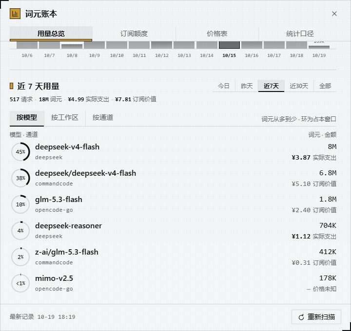
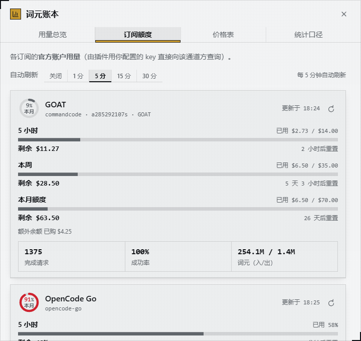
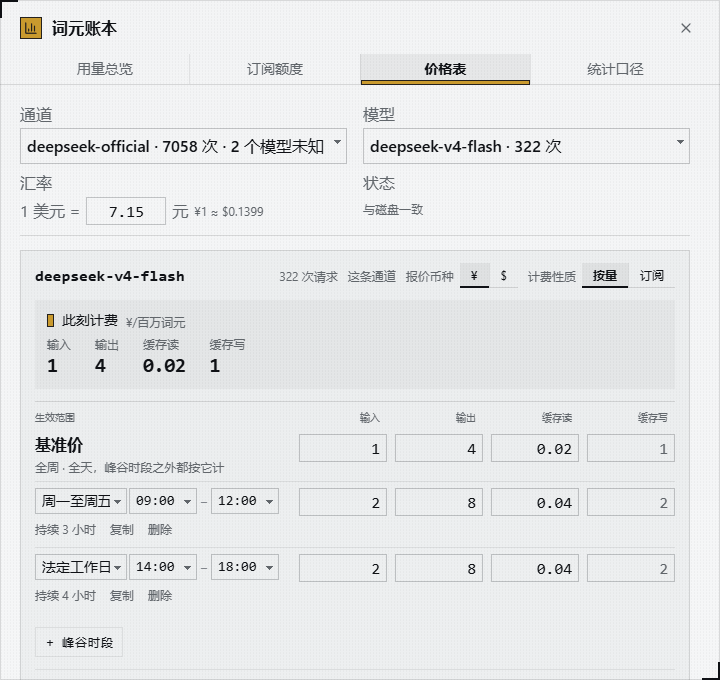
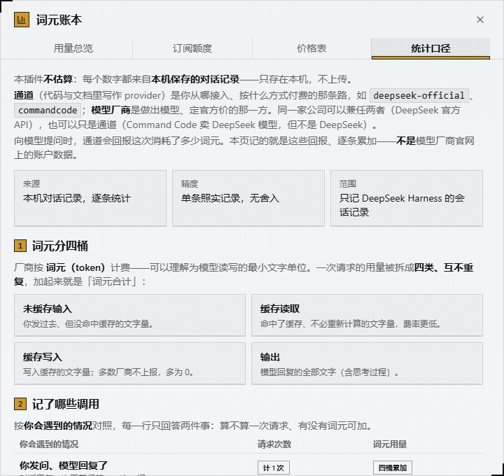
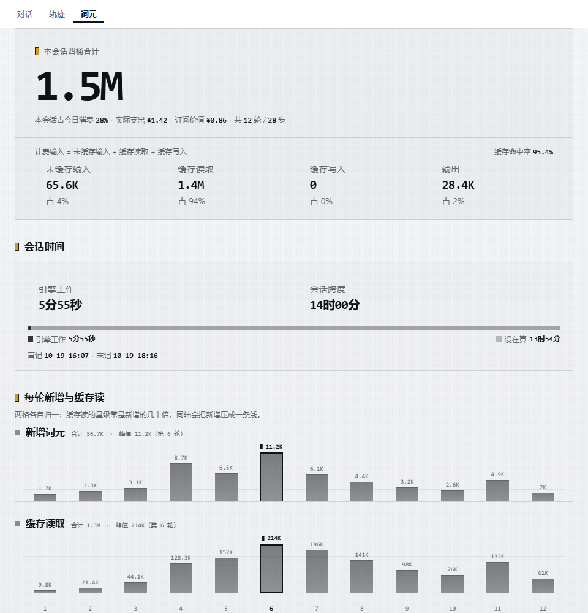

# dsh-tokbook

> **Doc meta** · role: entry · language: en · status: current · last-reviewed: 2026-10-19 · supersedes: —

A **cross-session token-usage ledger for DeepSeek Harness (DSH)**. The host half folds every billed model
call into one row of a local, per-day JSONL ledger and aggregates it with costs; the browser half shows it
from a four-tab overlay behind a sidebar-footer button, plus a **词元 / Tokens** page that the conversation
view ring gains for a single session.

| Light | Dark |
| --- | --- |
|  |  |

*All screenshots come from the preview bench, so the numbers are fixture data, not a real ledger.*

> **The UI is in Chinese (zh-CN)**, built by and for a Chinese-speaking DSH user; labels and hints are not
> translated. Data is plain JSON / JSONL in a directory you choose.

## Install

Needs DSH (`dsh --version`) and **pnpm 11** on your `PATH`.

```sh
dsh plugin --profile web add github:a285292107s/dsh-tokbook
```

`web` is the profile you install into — substitute your own. The repo carries the built `lib/`, so installing
runs no build script and needs no `allowBuilds` edit in the profile's `pnpm-workspace.yaml`. Rebuild
(`pnpm build`) and commit `lib/` after changing `src/` (see Development). The peer-dependency warning about
`@deepseek-ai/cordis` is expected — DSH provides cordis and the plugin resolves that same instance.

Then mount the plugin. It is a plain external plugin, not a `dsh.bundle` layer, so the profile names it in
`cordis.patch.yml`:

```yaml
# $DSH_HOME/profiles/<your profile>/cordis.patch.yml
- insert:
    - id: tokbook
      name: 'dsh-tokbook'
```

That row is all you need: the data directory defaults to `$DSH_HOME/tokbook/` and collection starts with
no configuration. Restart `dsh web` and refresh — the entry button appears at the bottom of the sidebar
(`sidebar.footer.action`). To install from a local checkout, use `dsh plugin --profile web add .`.

## What it records

The host listens to the persisted `session/event` stream and writes one JSONL row per billed model call
into the data directory (default `$DSH_HOME/tokbook/`, override with `path`). Two rules shape every number
it reports:

- **Only real billed calls.** A row comes from a message's `usage`, a compaction summary, a scheduled
  retry, or a turn that ended in an error. When the provider reported no usage the row still exists and
  still counts as a request; it just adds nothing to the token buckets. **Unknown is not zero** — nothing
  is estimated.
- **Prices are yours to write.** One `pricing.json` maps route → exact model string → one current price.
  Amounts split into **actual spend** (`metered`) and **subscription value** (`subscription` — what you
  avoided paying, not cash) and never merge into a single "cost".

A price is a single current value, so an amount answers *what the tokens I used recently would cost now*,
not what an invoice said. That is why money is reported only for windows of 30 days or less; the all-time
view reports tokens only. Tokens are facts, prices are not.

## The four tabs

1. **用量总览 / Overview** — today's totals, the token composition and a 14-day trend. Scrolling past it
   continues into **用量明细 / Usage detail**: the chosen window (today / yesterday / last 7 days / last
   30 days / all) crossed with three breakdowns — by model, by workspace, by provider route. Money appears
   only in the windows of 30 days or less.
2. **订阅额度 / Subscription quota** — account-level official usage, fetched from the provider's own API
   with your key, so it includes every tool and device on that subscription. Covers Command Code and
   OpenCode Go.
3. **价格表 / Pricing** — one model per screen: pick a route and a model, then write its current price
   (four tiers plus optional peak/off-peak slots). The FX rate and the statutory-holiday calendar live
   here too.
4. **统计口径 / Method** — what is not estimated, what is missing, and how the numbers reconcile.

| Usage detail, the overview's second section | Subscription quota |
| --- | --- |
|  |  |

| Pricing | Method |
| --- | --- |
|  |  |

Prices can also come from [models.dev](https://models.dev/api.json), a public USD catalogue: **查价 /
lookup** fuzzy-searches the selected model name for a candidate to fill, and **从 models.dev 补价 / sync**
fills gaps on USD routes the ledger has billed. Only first-party entries are trusted, and a hand-written
price is never overwritten.

## The session token page

The conversation view ring gains a **词元 / Tokens** view (`conversation.view`) that opens one **single
session** up by turn and by step over its whole lifetime.

- Header: the session's four-bucket total, its share of today's spend, actual spend and subscription
  value, turn and step counts, token composition and cache hit rate.
- **Subagents**: one row per direct subagent (creation label, tokens, share of all subagents, money), with
  nested delegations folded into their direct parent so no subtree is counted twice. The header stays
  session-only, and a manual fork — `parentSession` but not a subagent, per the host header's `origin` —
  never counts. No direct child, no block.
- **Session time**: engine work against session span, a bar for the time nothing was running, and the
  first and last record. Unmeasurable means omitted, not zero.
- Two per-turn charts (new tokens, cache reads) share one turn axis; hovering a bar shows that turn's
  read-out plus question and answer previews.
- **Per-turn detail**, collapsed by default: a turn header carries a three-phase bar (wait / generation /
  tools) and the same numbers, and expanding it lists one row per billed call with identity, money, its
  own bar and a `model / wait / generation / tools / tok per s` table.
- A footer sums unknown usage, failures and unpriced `(route, model)` pairs.

It is **read-only** against the ledger and config — its only write is a content width in the browser — and
needs no live session: it reads ledger rows plus the session's log on disk. A shared probe reads the
host's ledger generation every 3 seconds and refetches only when it changed, falling back to a 15-second
poll elsewhere; nothing is sent while the page is in the background.



> **Known degradation:** attributing rows to turns and steps needs the host's `sessionPersistence`. Without
> it the numbers still arrive, but every non-compaction row lands in an "unknown turn" block and the charts
> and session-time block do not render at all. The subagent block needs it for lineage and is omitted
> entirely — "cannot tell whether there are children" is not "there are none". Timings are local
> wall-clock, not billed duration.

## Configuration

Every key under `config:` on the mount row is optional:

```yaml
config:
  path: D:/data/tokbook        # default: $DSH_HOME/tokbook (or ~/.dsh/tokbook)
  recordCompaction: true       # default true — record compaction/summarize calls as rows
  plans:
    opencode-go:               # keyed by provider route
      enabled: false           # a plan is used as soon as a usable API key exists, unless disabled
      apiKey: '...'            # literal key, checked first
      apiKeyEnv: OPENCODE_GO_API_KEY   # else a credential reference name; defaults to the route's own
```

A second patch targeting `id: tokbook` **replaces** that row's `config` wholesale, so restate every key
you want to keep.

The quota tab fetches with your key but never estimates locally, and the browser half never holds the key.
A key without an active subscription is not an error: a balance-only provider gets a `balance` card, and
one that reports window percentages without a plan (OpenCode Go answering `403` for a valid key) gets a
`none` card. Only an endpoint that actually answered derives a gate — a timeout or `5xx` is *unknown*,
never "no subscription".

The dot on the sidebar button comes from the last successful snapshot and calls no provider API itself.

The data directory has **one writer**: startup writes an `owner.json` marker (pid and start time) and warns
instead of taking over when a live foreign process owns it, while a stale marker is taken over silently.
**Run a second host on its own `path`.** Deleting `pricing.json` keeps the ledger but prices every row as
unknown (¥0).

## Known gaps

- Quota plans hold a single API key per provider route; there is no multi-account rotation.
- `assistant/attempt` — an attempt that ended without producing a visible message — is not projected, so a
  failed attempt whose adapter reported `usage` only on the attempt stream is not recorded.
- Prices are per-current-value, so amounts cover the last 30 days only. A price-effective timeline is
  deliberately not built; the reasoning is in [`docs/DESIGN.md`](docs/DESIGN.md) §5.
- There is no cloud pricing feed: `pricing.json` is written by hand or filled from models.dev one candidate
  at a time. Route aliasing and vendor grouping are not modelled.

## Development

Source of truth is `src/` — host in `src/*.ts`, browser in `src/client/*.tsx`; `lib/` is the build output
committed to git so installs run no build script.

```sh
pnpm install
pnpm build        # tsc emits types, then esbuild bundles host + client
pnpm typecheck    # src/ only
pnpm test         # smoke (pure logic) + selfcheck (ledger) + selfcheck:ui (UI static bans)
```

`pnpm build` is a product, not a check: run it when you want a `src/` change to show up in a host or the
preview bench. `pnpm ledger` serves the same page against a real ledger directory, and without `--ledger`
it becomes the fixture bench these screenshots came from (`?dark=1`, `?tab=`, `?view=tokens`, `?quota=`).

The Chinese README ([`README.zh.md`](README.zh.md)) carries the `src/` layout tree and the development
loop. The contracts that keep the numbers honest are in [`docs/CONTRACTS.md`](docs/CONTRACTS.md); the
reasoning behind the shape is in [`docs/DESIGN.md`](docs/DESIGN.md); the map starts at
[`docs/INDEX.md`](docs/INDEX.md).

## License

[MIT](LICENSE)
