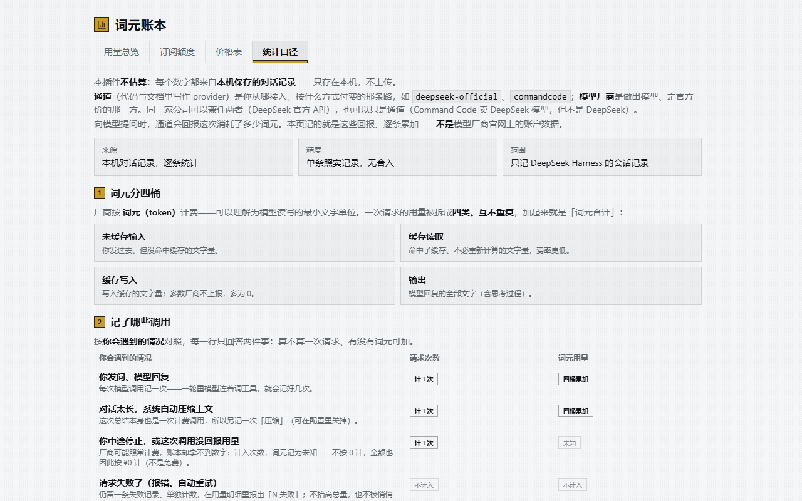

# dsh-tokbook

> **Doc meta** · role: entry · language: en · status: current · last-reviewed: 2026-11-24 · supersedes: —

A **cross-session token-usage ledger for DeepSeek Harness (DSH)**. The host half folds every billed model
call into one row of a local, per-day JSONL ledger and aggregates it with costs; the browser half shows it
as a three-tab page in the main column, opened from a row (`sidebar.panellist`) in the sidebar's panel list.
The conversation header adds two compact popovers, **词元 / Tokens** and **耗时 / Time**, one card per turn.

| Light | Dark |
| --- | --- |
|  |  |

*All screenshots come from the preview bench, so the numbers are fixture data, not a real ledger.*

> **The UI is in Chinese (zh-CN)**, built by and for a Chinese-speaking DSH user; labels and hints are not
> translated. Data is plain JSON / JSONL in a directory you choose.

## Install

Needs DSH (`dsh --version`) and **pnpm 11** on your `PATH`.

```sh
dsh plugin --profile web add github:a285292107s/dsh-tokbook
```

`web` is the profile you install into — substitute your own. This package is a **`dsh.bundle` package**:
`dsh.bundle.patch` in `package.json` points at the bundled `cordis.patch.yml`, and DSH selects that layer
into the profile after a successful install. Its patch inserts the `tokbook` row, so **do not** add an
`insert` row by hand. The data directory defaults to `$DSH_HOME/tokbook/` and collection starts with no
configuration; add a `config:` block only to change something (see Configuration), with an override
example in [`cordis.patch.example.yml`](cordis.patch.example.yml).

Restart `dsh web` and refresh — the **词元账本** row appears in the sidebar's panel list, just above
**更多 / More**; selecting it opens the ledger page in the main column (`main` + `sidebar.panellist`).

The repo carries the built `lib/`, so installing runs no build script and needs no `allowBuilds` edit in
the profile's `pnpm-workspace.yaml`. Rebuild (`pnpm build`) and commit `lib/` after changing `src/` (see
Development). The peer-dependency warning about `@deepseek-ai/cordis` is expected — DSH provides cordis
and the plugin resolves that same instance. To install from a local checkout, use
`dsh plugin --profile web add .`.

**Migrating from the old plain-plugin install:** the profile's `cordis.patch.yml` may still carry a
hand-written `insert` row (`id: tokbook`). Remove it before selecting this bundle, or the profile ends
up with two `tokbook` rows that share one id.

## What it records

The host listens to the persisted `session/event` stream and writes one JSONL row per billed model call
into the data directory (default `$DSH_HOME/tokbook/`, override with `path`). Two rules shape every number
it reports:

- **Only real billed calls.** A row comes from a message's `usage`, a compaction summary, a scheduled
  retry, or a turn that ended in an error. When the provider reported no usage the row still exists and
  still counts as a request; it just adds nothing to the token buckets. **Unknown is not zero** — nothing
  is estimated.
- **Prices are yours to write.** One `pricing.json` maps route → exact model string → one current price.
  Amounts split into **actual spend** (`metered`) and **subscription value** (`subscription` — what you
  avoided paying, not cash) and never merge into a single "cost".

A price is a single current value, so an amount answers *what the tokens I used recently would cost now*,
not what an invoice said. That is why money is reported only for windows of 30 days or less; the all-time
view reports tokens only. Tokens are facts, prices are not.

## The three tabs

1. **用量总览 / Overview** — four full-width blocks, top to bottom.
   **Today** carries the headline token figure, the four-bucket composition, and a compact money rail
   (actual spend, subscription value, 7-day spend). **订阅额度 / subscription quota** follows as two
   provider cards side by side — account-level official usage fetched from the provider's own API with
   your key (so it includes every tool and device on that subscription; covers Command Code and
   OpenCode Go); each window reports used share and reset time only. Then the **14-day trend** (tokens as
   bars, spend as a line, with the window's four-bucket split as a one-line footnote) and **用量明细 /
   Usage detail** as a full-width table. Money appears only in windows of 30 days or less. The cards keep
   their full-row width; their internal grids collapse (today: three zones → two → one, quota: two cards
   → one) as the container narrows.
2. **价格表 / Pricing** — a selector card (route, model, FX rate), then a full-width workbench: the editable
   price table on the left holds the four tiers plus optional peak/off-peak slots, and a compact live rail on
   the right reports the four rates in force now (or just "base price" when no slot is active). A full-width
   **statutory-holiday calendar** card sits below it, one calendar per year: click a start and end day to mark
   a stretch of holidays, and edit or delete any stretch (deletions, and edits, are undoable).
3. **统计口径 / Method** — a centered reading column of full-width document cards: intro and quick facts,
   the four token buckets, the call-classification table, reconciliation gaps, field mapping, and the data
   footer. What is not estimated, what is missing, and how the numbers reconcile.

| Usage detail, the overview's last full-width block | Subscription quota, the band between today and the trend |
| --- | --- |
|  |  |

| Pricing | Method |
| --- | --- |
|  |  |

Prices can also come from [models.dev](https://models.dev/api.json), a public USD catalogue: **查价 /
lookup** fuzzy-searches the selected model name for a candidate to fill, and **从 models.dev 补价 / sync**
fills gaps on USD routes the ledger has billed. Only first-party entries are trusted, and a hand-written
price is never overwritten.

## The session tokens popover

A **词元 / Tokens** button in the session header opens a compact popover anchored to the header: one card
per turn, newest first. Each card's split ring is cut into the four token buckets — uncached input, cache
read, cache write, output — with the turn's token total in the centre; the table beside it gives each
bucket's mark, label, tokens and share. Output is solid; the other three use brightness plus vertical,
horizontal and diagonal hatching, so the composition reads without colour. The ring is a full circle, not
normalised to the heaviest turn; compare turns by the centre figures. Zero buckets stay listed as 0 / 0%.
A turn whose calls reported no usage says so instead of showing 0; a partly reported turn sums only what
was reported and names the gap beside the step count. Failed attempts are counted in the step total but
contribute no tokens, so the card names them as (含 N 次失败). Between-turn and unknown-turn rows are left out.

It shares one session view (`GET /tokbook/session`) and one popover shell with the timing popover: read-only,
fetched only when opened, then following the same ledger probe. It reports **no money** — money is the ledger
page's current-price view, and mixing it into a token reading would conflate measured tokens with a
recomputed price.

## The session timing popover

A **耗时 / Time** button in the session header opens a compact popover anchored to the header: one card
per turn, newest first. Each card's left edge carries a split ring: the centre is that turn's engine work,
the arc is cut into wait / generation / tools (or one crosshatched model segment when the channel cannot
split them), and the table beside it gives each segment's mark, label, duration and share. Each card also
names the provider / model used by the turn (when more than one model was used, it reports the first and the
count; the full list is in the hover title). The ring is
always a full circle — it shows composition, not a length normalised to the slowest turn; compare turns by
the centre figures. Turns whose steps carry no timing say so instead of
showing 0. The popover fetches only when opened and then follows the same ledger probe; between-turn and
unknown-turn rows are left out.

It is **read-only** against the ledger and config and needs no live session: it reads the session's log on
disk for event times. Timings are local wall-clock, not billed duration. Attributing billed rows to turns
and steps needs the host's `sessionPersistence`; without it the view has no turns, so the popover shows no
card at all.

## Configuration

Every key under `config:` on the mount row is optional:

```yaml
config:
  path: D:/data/tokbook        # default: $DSH_HOME/tokbook (or ~/.dsh/tokbook)
  recordCompaction: true       # default true — record compaction/summarize calls as rows
  plans:
    opencode-go:               # keyed by provider route
      enabled: false           # a plan is used as soon as a usable API key exists, unless disabled
      apiKey: '...'            # literal key, checked first
      apiKeyEnv: OPENCODE_GO_API_KEY   # else a credential reference name; defaults to the route's own
```

A second patch targeting `id: tokbook` **replaces** that row's `config` wholesale, so restate every key
you want to keep.

The subscription quota cards fetch with your key but never estimate locally, and the browser half never holds the key.
A key without an active subscription is not an error: a balance-only provider gets a `balance` card, and
one that reports window percentages without a plan (OpenCode Go answering `403` for a valid key) gets a
`none` card. Only an endpoint that actually answered derives a gate — a timeout or `5xx` is *unknown*,
never "no subscription".

The dot on the sidebar row's icon comes from the last successful snapshot and calls no provider API itself.

The data directory has **one writer**: startup writes an `owner.json` marker (pid and start time) and warns
instead of taking over when a live foreign process owns it, while a stale marker is taken over silently.
**Run a second host on its own `path`.** Deleting `pricing.json` keeps the ledger but prices every row as
unknown (¥0).

## Known gaps

- Quota plans hold a single API key per provider route; there is no multi-account rotation.
- `assistant/attempt` — an attempt that ended without producing a visible message — is not projected, so a
  failed attempt whose adapter reported `usage` only on the attempt stream is not recorded.
- Prices are per-current-value, so amounts cover the last 30 days only. A price-effective timeline is
  deliberately not built; the reasoning is in [`docs/DESIGN.md`](docs/DESIGN.md) §5.
- There is no cloud pricing feed: `pricing.json` is written by hand or filled from models.dev one candidate
  at a time. Route aliasing and vendor grouping are not modelled.

## Development

Source of truth is `src/` — host in `src/*.ts`, browser in `src/client/*.tsx`; `lib/` is the build output
committed to git so installs run no build script.

```sh
pnpm install
pnpm build        # tsc emits types, then esbuild bundles host + client
pnpm typecheck    # src/ only
pnpm test         # smoke (pure logic) + selfcheck (ledger) + selfcheck:ui (UI static bans)
```

`pnpm build` is a product, not a check: run it when you want a `src/` change to show up in a host or the
preview bench. `pnpm ledger` serves the same page against a real ledger directory, and without `--ledger`
it becomes the fixture bench these screenshots came from (`?dark=1`, `?tab=`, `?view=timing` for both header popovers, `?quota=`).

The Chinese README ([`README.zh.md`](README.zh.md)) carries the `src/` layout tree and the development
loop. The contracts that keep the numbers honest are in [`docs/CONTRACTS.md`](docs/CONTRACTS.md); the
reasoning behind the shape is in [`docs/DESIGN.md`](docs/DESIGN.md); the map starts at
[`docs/INDEX.md`](docs/INDEX.md).

## License

[MIT](LICENSE)
