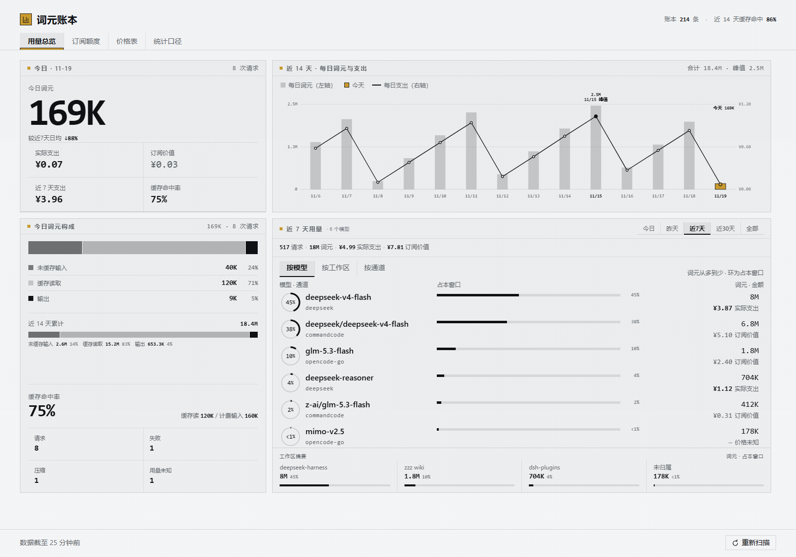
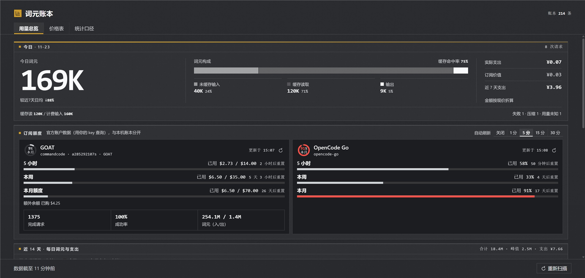
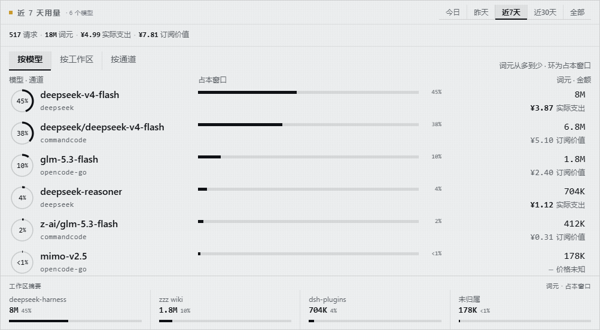
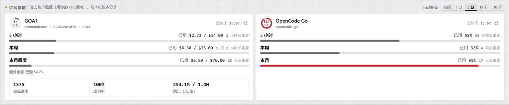
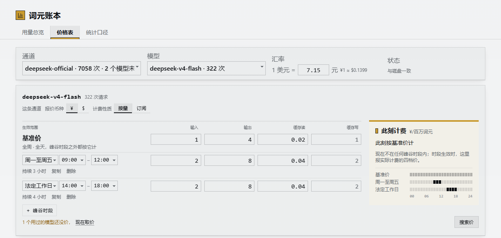
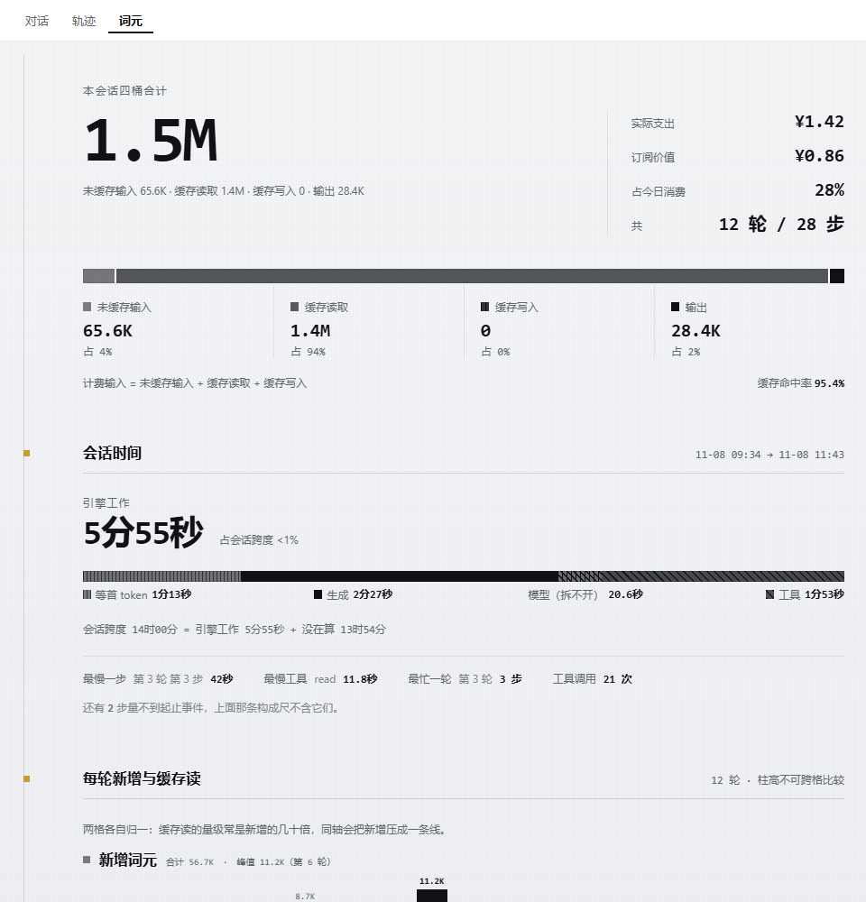

# dsh-tokbook

> **Doc meta** · role: entry · language: en · status: current · last-reviewed: 2026-11-19 · supersedes: —

A **cross-session token-usage ledger for DeepSeek Harness (DSH)**. The host half folds every billed model
call into one row of a local, per-day JSONL ledger and aggregates it with costs; the browser half shows it
as a four-tab page in the main column, opened from a row (`sidebar.panellist`) in the sidebar's panel list,
plus a **词元 / Tokens** page that the conversation view ring gains for a single session.

| Light | Dark |
| --- | --- |
|  |  |

*All screenshots come from the preview bench, so the numbers are fixture data, not a real ledger.*

> **The UI is in Chinese (zh-CN)**, built by and for a Chinese-speaking DSH user; labels and hints are not
> translated. Data is plain JSON / JSONL in a directory you choose.

## Install

Needs DSH (`dsh --version`) and **pnpm 11** on your `PATH`.

```sh
dsh plugin --profile web add github:a285292107s/dsh-tokbook
```

`web` is the profile you install into — substitute your own. This package is a **`dsh.bundle` package**:
`dsh.bundle.patch` in `package.json` points at the bundled `cordis.patch.yml`, and DSH selects that layer
into the profile after a successful install. Its patch inserts the `tokbook` row, so **do not** add an
`insert` row by hand. The data directory defaults to `$DSH_HOME/tokbook/` and collection starts with no
configuration; add a `config:` block only to change something (see Configuration), with an override
example in [`cordis.patch.example.yml`](cordis.patch.example.yml).

Restart `dsh web` and refresh — the **词元账本** row appears in the sidebar's panel list, just above
**更多 / More**; selecting it opens the ledger page in the main column (`main` + `sidebar.panellist`).

The repo carries the built `lib/`, so installing runs no build script and needs no `allowBuilds` edit in
the profile's `pnpm-workspace.yaml`. Rebuild (`pnpm build`) and commit `lib/` after changing `src/` (see
Development). The peer-dependency warning about `@deepseek-ai/cordis` is expected — DSH provides cordis
and the plugin resolves that same instance. To install from a local checkout, use
`dsh plugin --profile web add .`.

**Migrating from the old plain-plugin install:** the profile's `cordis.patch.yml` may still carry a
hand-written `insert` row (`id: tokbook`). Remove it before selecting this bundle, or the profile ends
up with two `tokbook` rows that share one id.

## What it records

The host listens to the persisted `session/event` stream and writes one JSONL row per billed model call
into the data directory (default `$DSH_HOME/tokbook/`, override with `path`). Two rules shape every number
it reports:

- **Only real billed calls.** A row comes from a message's `usage`, a compaction summary, a scheduled
  retry, or a turn that ended in an error. When the provider reported no usage the row still exists and
  still counts as a request; it just adds nothing to the token buckets. **Unknown is not zero** — nothing
  is estimated.
- **Prices are yours to write.** One `pricing.json` maps route → exact model string → one current price.
  Amounts split into **actual spend** (`metered`) and **subscription value** (`subscription` — what you
  avoided paying, not cash) and never merge into a single "cost".

A price is a single current value, so an amount answers *what the tokens I used recently would cost now*,
not what an invoice said. That is why money is reported only for windows of 30 days or less; the all-time
view reports tokens only. Tokens are facts, prices are not.

## The three tabs

1. **用量总览 / Overview** — a responsive card grid on 12 columns, in asymmetric 5/7, 7/5, 12 rows.
   **Today** (tokens, actual spend as the headline figure, cache hit rate) pairs with **订阅额度 /
   subscription quota** — account-level official usage fetched from the provider's own API with your key
   (so it includes every tool and device on that subscription; covers Command Code and OpenCode Go).
   Beneath, the **14-day trend** (tokens as bars, spend as a line) pairs with **today's token composition**;
   **用量明细 / Usage detail** takes the full row. Money appears only in windows of 30 days or less.
   Narrow containers collapse the grid to one column and the quota cards to two, then one.
2. **价格表 / Pricing** — a card grid: a full-width selector strip, then **price detail** (7 columns)
   beside the **statutory-holiday calendar** (5 columns). Pick a route and a model, then write its
   current price (four tiers plus optional peak/off-peak slots); the FX rate lives in the selector strip.
3. **统计口径 / Method** — a card grid: intro and quick facts, four token buckets (5 columns) beside the
   call-classification table (7 columns), then reconciliation gaps, field mapping, and data footer.
   What is not estimated, what is missing, and how the numbers reconcile.

| Usage detail, the overview's last full-width block | Subscription quota, a card row below the overview |
| --- | --- |
|  |  |

| Pricing | Method |
| --- | --- |
|  |  |

Prices can also come from [models.dev](https://models.dev/api.json), a public USD catalogue: **查价 /
lookup** fuzzy-searches the selected model name for a candidate to fill, and **从 models.dev 补价 / sync**
fills gaps on USD routes the ledger has billed. Only first-party entries are trusted, and a hand-written
price is never overwritten.

## The session token page

A **词元 / Tokens** button in the session header opens the page as a **right-sidebar tab** that reads one
**single session** by turn and by step over its whole lifetime — next to the conversation, closeable
when you are done. It answers what the cross-session ledger cannot: **where this session's time went**,
and then what it used in tokens and money. The layout follows the sidebar width: a wider body
while the pane is wide, a single-column compact body once it drops below 640px.

- **Session time**, the page's lead reading: engine work (model + tool time summed over its steps)
  against session span — wait / generation / tools as one bar, the equation
  `span = work + not computing`, the first and last record times, the share of the span and the
  turn / step counts, and the slowest step, slowest tool, busiest turn and tool-call count.
  Unmeasurable means omitted, not zero.
- **Tokens and money**, second because time leads the page: the session's four-bucket total as one
  number, the four bucket figures in a line beneath it, and three facts to the right — actual spend,
  subscription value, share of today's spend. Under it, one proportional composition bar plus four
  read-out columns with their shares, the billing-input formula (uncached input + cache read + cache
  write) and the cache hit rate.
- **Per-turn time**, collapsed by default and laid out as numbered entries on one vertical line:
  a turn header leads with the turn's engine work, then its steps, tokens and model, then a
  three-phase bar normalised to the heaviest turn (drawn on a full-width track) plus the same
  numbers. Sort by oldest / newest / **most time first**. Expanding it lists one row per billed
  call: the step's wall time first, beside its number, then the
  `model / wait / generation / tools / tok per s` table, then buckets and money. Between-turns and
  unknown-turn blocks stay separate.
- **Subagents**, last because nothing else on the page includes them: one row per direct subagent
  (creation label, tokens, share of all subagents, money), with nested delegations folded into their
  direct parent so no subtree is counted twice. The header stays session-only, and a manual fork —
  `parentSession` but not a subagent, per the host header's `origin` — never counts. No direct child,
  no block.
- A footer sums unknown usage, failures and unpriced `(route, model)` pairs.

It is **read-only** against the ledger and config and needs no live session: it reads ledger rows plus
the session's log on disk. A shared probe reads the host's ledger generation every 3 seconds and
refetches only when it changed, falling back to a 15-second poll elsewhere; nothing is sent while the
page is in the background.



> **Known degradation:** attributing rows to turns and steps needs the host's `sessionPersistence`. Without
> it the numbers still arrive, but every non-compaction row lands in an "unknown turn" block and the
> session-time block does not render at all. The subagent block needs it for lineage and is omitted
> entirely — "cannot tell whether there are children" is not "there are none". Timings are local
> wall-clock, not billed duration.

## Configuration

Every key under `config:` on the mount row is optional:

```yaml
config:
  path: D:/data/tokbook        # default: $DSH_HOME/tokbook (or ~/.dsh/tokbook)
  recordCompaction: true       # default true — record compaction/summarize calls as rows
  plans:
    opencode-go:               # keyed by provider route
      enabled: false           # a plan is used as soon as a usable API key exists, unless disabled
      apiKey: '...'            # literal key, checked first
      apiKeyEnv: OPENCODE_GO_API_KEY   # else a credential reference name; defaults to the route's own
```

A second patch targeting `id: tokbook` **replaces** that row's `config` wholesale, so restate every key
you want to keep.

The subscription quota cards fetch with your key but never estimate locally, and the browser half never holds the key.
A key without an active subscription is not an error: a balance-only provider gets a `balance` card, and
one that reports window percentages without a plan (OpenCode Go answering `403` for a valid key) gets a
`none` card. Only an endpoint that actually answered derives a gate — a timeout or `5xx` is *unknown*,
never "no subscription".

The dot on the sidebar row's icon comes from the last successful snapshot and calls no provider API itself.

The data directory has **one writer**: startup writes an `owner.json` marker (pid and start time) and warns
instead of taking over when a live foreign process owns it, while a stale marker is taken over silently.
**Run a second host on its own `path`.** Deleting `pricing.json` keeps the ledger but prices every row as
unknown (¥0).

## Known gaps

- Quota plans hold a single API key per provider route; there is no multi-account rotation.
- `assistant/attempt` — an attempt that ended without producing a visible message — is not projected, so a
  failed attempt whose adapter reported `usage` only on the attempt stream is not recorded.
- Prices are per-current-value, so amounts cover the last 30 days only. A price-effective timeline is
  deliberately not built; the reasoning is in [`docs/DESIGN.md`](docs/DESIGN.md) §5.
- There is no cloud pricing feed: `pricing.json` is written by hand or filled from models.dev one candidate
  at a time. Route aliasing and vendor grouping are not modelled.

## Development

Source of truth is `src/` — host in `src/*.ts`, browser in `src/client/*.tsx`; `lib/` is the build output
committed to git so installs run no build script.

```sh
pnpm install
pnpm build        # tsc emits types, then esbuild bundles host + client
pnpm typecheck    # src/ only
pnpm test         # smoke (pure logic) + selfcheck (ledger) + selfcheck:ui (UI static bans)
```

`pnpm build` is a product, not a check: run it when you want a `src/` change to show up in a host or the
preview bench. `pnpm ledger` serves the same page against a real ledger directory, and without `--ledger`
it becomes the fixture bench these screenshots came from (`?dark=1`, `?tab=`, `?view=tokens&pane=<px>`, `?quota=`).

The Chinese README ([`README.zh.md`](README.zh.md)) carries the `src/` layout tree and the development
loop. The contracts that keep the numbers honest are in [`docs/CONTRACTS.md`](docs/CONTRACTS.md); the
reasoning behind the shape is in [`docs/DESIGN.md`](docs/DESIGN.md); the map starts at
[`docs/INDEX.md`](docs/INDEX.md).

## License

[MIT](LICENSE)
