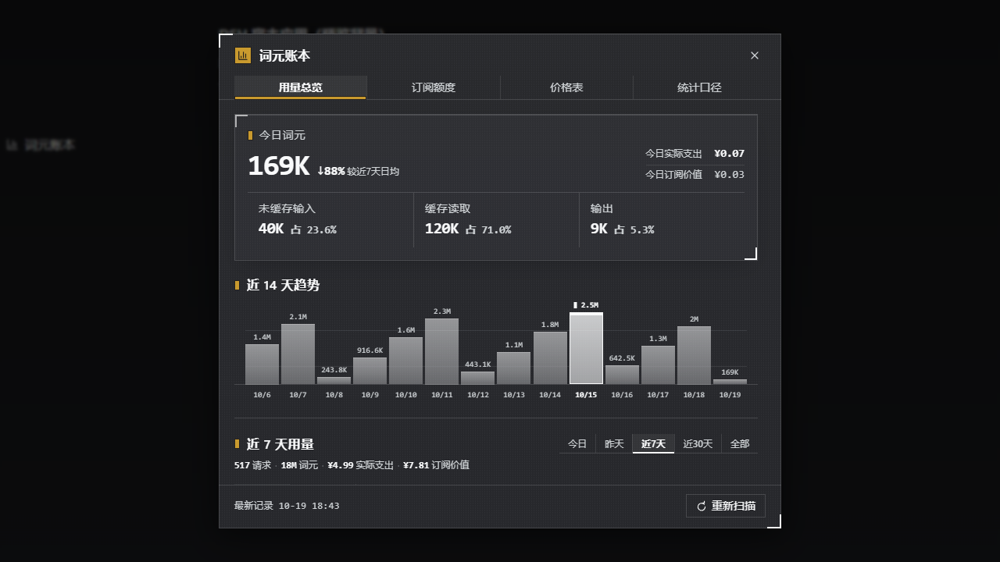

# dsh-tokbook

> **Doc meta** · role: entry · language: zh-CN · status: current · last-reviewed: 2026-10-16 · supersedes: —

> 英文门面见 [`README.md`](README.md);本文件是**维护者的那一份**,多带 `src/` 布局树与开发细节。

DeepSeek Harness(DSH)的**跨会话 token 用量账本**插件。host 半区把每次通道计费模型调用折成
一行、写入按本地日持久化的 JSONL 账本,再对外提供**带成本**的聚合;browser 半区从**侧边栏
footer 按钮**(`sidebar.footer.action`)弹出**浮窗**(`shell.overlay`),内含四个 tab(按界面
从左到右):**用量总览**(今日 + 词元构成 + 近 14 天趋势;往下滚接**用量明细**——窗口 ×
按模型 / 按工作区 / 按通道,金额只在近 30 天及更短的窗口里给)、**订阅额度**(用你的 key 向通道查
账户级官方用量)、**价格表**(选一个通道 + 模型,填它的**当前价**;峰谷时段、汇率与节假日年历也在这里)、
**统计口径**(不估算的口径、漏项与对账)。

另有一格不在浮窗里:插件还在**对话视图环**里加了**词元**页(`conversation.view`)——单会话全生命周期,
按轮次与步骤摊开,见下文「[会话词元页](#会话词元页conversationview)」。

> **用量明细不是第五个 tab。** 它是**用量总览**页往下滚的第二段(`ProviderPanel`,
> `section[aria-label="用量明细"]`)。此前这一句写「五个 tab」,是 `用量明细并入总览` 那次改动
> (f7c7e27)漏掉的:**界面 tab 条上只有四个**,`src/client/LedgerOverlay.tsx` 的 tablist 是唯一真源。

| 浅色 | 深色 |
| --- | --- |
|  |  |

*两张都抓自预览台,所以数字是 fixture 数据,不是真账本。*

两条贯穿全插件的原则:

- **只记真实的计费调用。** 一行来自四类会话事件:`assistant/message`(用它的 `usage`)、
  `compaction/summary`、`llm/retry`(安排一次重试 = 一次失败尝试)、`reason.kind === 'error'`
  的 `turn/end`。通道没上报用量的调用**仍写一行、仍计入次数**,但没有 token 可加——**未知不等于 0**,不估算。
  **已知缺口**:`assistant/attempt`(流结束时没产出可见消息的那次尝试)当前不投影,所以 adapter
  只把 `usage` 放进 attempt 的 stream 上报的那种失败尝试不入账;一次 attempt 既没安排重试、也没以
  error 收尾时一行都不写。补它得按 retry 生命周期配对尝试,是独立任务(`src/usage-record.ts` 有同一条注释)。
- **金额由你自己写价。** 一份 `pricing.json`(路由 → 精确模型串 → **一份当前价**),金额分
  「**实际支出**」与「**订阅价值**」两桶。价只有一份,所以它衡量的是**最近用掉的 token 值多少钱**
  ——**不是**当时那笔账单,金额因此只在 30 天及更短的窗口里给(「全部账本」只给词元)。
  没定价的是**价格未知**(按 ¥0 计,但会在界面上列出来);费率为 0 才是免费。

界面词与代码/契约的逐条对应见 [`docs/CONTRACTS.md`](docs/CONTRACTS.md) 的「术语」段。**界面规格的真源是代码**:
token 与「什么时候用哪个」在 `src/client/styles/tokens.ts` 的注释里,各个面长什么样看 `src/client/styles/**`;
静态可判定的那批禁令由 `pnpm selfcheck:ui` 强制,其余要人看。文档树地图见 [`docs/INDEX.md`](docs/INDEX.md)。

> **术语**:本文档与界面说的**通道**就是代码与契约里的 provider —— 你从哪接入、按什么方式付费的
> 那条路,route key 即账本里记录的通道标识。做模型、定官方价的那一方叫**模型厂商**,不是通道;
> 同一家公司可以兼任两者,也可以只是通道。

数据来源沿用 [dsh-token-usage](https://github.com/LaoYueHanNi/dsh-token-usage) 参考:**逐请求行**而非逐会话
聚合,外加本机手写 ¥/M 价格表,按**当前价**折算金额。

## 安装

需要 DSH(`dsh --version`)与 PATH 上的 **pnpm 11**——下面那个白名单键是 pnpm 11 的写法。

```sh
dsh plugin --profile web add github:a285292107s/dsh-tokbook
```

`web` 只是**你要装进去的那个 profile**:**换成你自己的名字**。该 profile 还不存在时,这条命令会
顺手初始化它。本文其余地方写 `web` 也是同一个意思。

本仓库发布的是**源码而不是构建产物**:`lib/` 是 gitignore 的构建产物,所以 pnpm 在安装时通过包的
`prepare` 脚本现场构建。pnpm 默认不允许依赖跑构建脚本,所以第一次会停下并打印它要的那一行——
把它加进 profile 的 `pnpm-workspace.yaml` 再跑一次同样的命令;也可以先直接重跑一次:pnpm 有时
会自己把它追加成 `…: set this to true or false`,那时你只要把它翻成 `true`。

```yaml
# $DSH_HOME/profiles/web/pnpm-workspace.yaml
allowBuilds:
  dsh-tokbook@https://codeload.github.com/a285292107s/dsh-tokbook/tar.gz/<commit>: true
```

那个键**不是包名**:它是「包名 @ 这次解析到的那个确切 commit」。所以照 pnpm 打印的原样粘贴,
别自己敲;`main` 一动它就过期,升级之后要重新批一次。

pnpm 还会报一句 peer dependency `@deepseek-ai/cordis` 缺失的警告。**那是预期的、无害的**:
cordis 由 DSH 自己提供,插件解析到的就是同一个实例。

然后把这个插件挂进 profile。它是**普通外部插件**(不是 `dsh.bundle` 层),所以 profile 里要按包名点名:

```yaml
# $DSH_HOME/profiles/<你的 profile>/cordis.patch.yml
- insert:
    - id: tokbook
      name: 'dsh-tokbook'
```

挂载行就这些就够:数据目录默认 `$DSH_HOME/tokbook/`,这个插件**不配置也会开始记账**。只有要改
什么才加 `config:` 块(见[配置](#配置))。

重启 `dsh web` 并刷新浏览器。入口按钮在侧边栏底部,浮窗是一个 shell overlay。挂载行的示例见
[`cordis.patch.example.yml`](cordis.patch.example.yml)。

从本地检出安装则用 `dsh plugin --profile web add .`。

重载链活着时(见 [`docs/HMR.md`](docs/HMR.md)),`pnpm build` 会经 `dsh-hmr` 行热替换 **host** 半区;
browser 刷新页面拾取,链没活着时硬刷新永远是兜底。

## 它怎么记 token

host 监听持久化 `session/event` 流,把每次通道计费模型调用折成一行 JSONL 写进数据目录(默认
`$DSH_HOME/tokbook/`,可用 `path` 配置)。**事件 → 行的逐条投影在 `src/usage-record.ts`**:

- **用量未知 ≠ 0。** 通道没上报 `usage` 的计费调用(中途取消的请求、没回报用量的 summarize)
  **仍写一行、仍计入请求次数**,但四个 token 桶一个都不加,也不按 0 词元冒充。
- **新鲜度不靠读路径等。** 打开浮窗那次读只做**廉价探测**(列会话 + 比对变更签名);要折叠时才把
  **权威 walk 排到后台**并按 15 s 节流——账本最多晚一个节流窗口,要立刻全量走一遍用**重新扫描**。
  walk 在跑时浮窗靠只读探针 `/tokbook/sync` 把状态追到落定(页脚那句「正在重新扫描…」/「上次重新
  扫描失败:…」),落定后再拉一次概览。

### 一个数据目录,一个写入进程

账本、折叠、解析缓存与 refile 都假设**单个 host 进程**写给定数据目录:启动写 `owner.json` 标记
(pid + 启动时间),**检测到存活的异进程已占用时告警**(陈旧标记静默接管)。第二个 host 请指向
自己的 `path`(见 [配置](#配置));去重与热重载边界见 [`docs/HMR.md`](docs/HMR.md)。

## 会话词元页(`conversation.view`)

除了侧栏按钮与浮窗,插件还在**对话视图环**里加了一格:**词元**(`conversation.view`,id
`dsh-tokbook-tokens`)。它答的是浮窗答不了的那个问题——**这一个会话**的词元与钱,按轮次、按步骤摊开:

- **抬头**:本会话四桶合计(占今日消费、实际支出 / 订阅价值、共 N 轮 / N 步),以及本会话的
  **词元构成带**(未缓存输入 / 缓存读取 / 缓存写入 / 输出,每格带占比)与**缓存命中率**。
- **会话时间**:`引擎工作` 与 `会话跨度` 两格,加上两者差额的比值尺(差额就是**没在算**的那段),
  以及首记 / 末记。两格都量不到时整块不出——**量不到就不是 0**。
- **每轮新增 / 缓存读两格图**:两格各自归一到自己的量级,共用一条轮次轴;指针停在柱上出那一轮的
  读数卡(第 N 轮 / N 步 / 词元 / 支出 / 四桶 + 提问与回答预览)。
- **按轮次明细**:默认**全部收起**;展开一轮就是它的步骤行——一次计费调用一行,带身份、钱、
  三段用时尺(等首 token / 生成 / 工具)与 `模型 · 首token · 生成 · 工具 · tok/s` 那张用时表。
  末尾的「轮间」与「轮次未知」**分列不合并**,不会被读成第 13、14 轮。
- **脚注**:整会话的 `用量未知 N 次 · 失败 N 次 · 未定价 N 个 (通道, 模型)`。

它**对账本与配置完全只读**(唯一的写入是浏览器本地记的阅读列宽),也**不需要活的会话**:读的是
已经入账的行 + 该会话已落盘的日志,15 s 轮询一次,页面在后台时整个不发请求。

> **已知降级**:把行归属到轮次 / 步骤要靠宿主的 `sessionPersistence`。它缺席时(独立查看器就不提供)
> 数字照旧,但非压缩行全部落进「轮次未知」那一块,而且**两格图与会话时间整块不出**。用时量的是
> **本机墙钟**,不是计费时长。

## 成本与价格表

金额按**当前价**折算:**每个 (通道路由, 精确模型串) 只有一份价**(四档基准价 + 可选的**峰谷时段**),
账本里**所有记录**都用它——先取那四档基准价,再按记录**本地时间**取生效的峰谷时段(没被时段覆盖的
时间按基准价)。所以**一次改价会让全部金额一起变**;一条 (路由, 模型) 没有价 → **价格未知**(按 ¥0 计)。

**它是「现价刻度」,不是历史账单。** 拿今天的价去折算一年前的用量,既不是那笔支出、也不是今天的
价值;所以金额只在**近 30 天及更短的窗口**里给,**「全部账本」只给词元**(词元是事实,放多久都成立)。
近 30 天里也可能发生厂商调价,那部分偏差是已知且接受的(维护者本机数据实测约 1–2%)。为什么不做
历史价表,见 [`docs/DESIGN.md`](docs/DESIGN.md) §5 末。

**峰谷时段自带星期集合**(每天 / 周一至周五 / 工作日 / 周末四档)与小时区间。其中「工作日」与
「周一至周五」的差别就落在节假日上,靠保留键 `$calendar` 的**法定节假日年历**(`YYYY` → 放假日闭
区间,按年收录)判定:年历里查不到那一年就是**未知**,「工作日」此时退化成「周一至周五」——
**安全方向**,宁可多按高峰算;调休上班日不用收(周末上不上班都是闲时价),所以这份年历只收放假日。

金额拆成两个桶,浮窗分开显示、绝不混为单一「支出」:**实际支出**(`spend`)= `metered` 路由按现价
折算的钱;**订阅价值**(`subscriptionValue`)= `subscription` 路由按你写的价折算的「省了多少」,
**不是现金**。计费性质是**通道路由**属性(价表 `$billing` 的一条),省略按 `metered`。

价格**全部由你自己写**,只有一份文件 `pricing.json`(默认 `$DSH_HOME/tokbook/`):路由 → 精确模型串 →
**一份价**(四档价 + 可选 `slots` 峰谷时段),像一个能手改的 JSON:

```json
{ "deepseek-official": { "deepseek-v4-flash": {
    "inputPerMillion": 1, "outputPerMillion": 4, "cacheReadPerMillion": 0.02,
    "slots": [{ "days": "workdays", "start": 14, "end": 18, "outputPerMillion": 8 }] } } }
```

**四档价用这条通道自己的报价币种记**(第三个保留键 `$currency`,省略 = 人民币/百万词元)——厂商按
美元报价的通道就把美元价原样写进去。字段与校验的真源是 `src/types.ts`
与 `src/pricing.ts` 的 `parsePriceInput`(写入 handler 只做传输);畸形文件只把受影响的 (路由, 模型) 降级为价格未知(¥0)。
**旧版文件里的价段数组仍读得进来**:读路径取生效时刻最晚的那一段(就是今天仍在生效的价),更早的段
按它重算,下一次保存文件就写成上面这个形态;新写入**不再接受**数组或 `from`(报错会直说原因)。

**`$fx` 是唯一的换算率**(手填、不联网):把按美元报价的通道折成人民币——计价真的读它,所以
**改汇率会重算那些通道的金额**;人民币通道一分不动,已写的价也一个数字都不改。没填汇率就
换算不出来:美元通道算不出人民币(读作价格未知,绝不按 1 算),也切不过去(切报价币种的前提是有汇率)。

**价格表 tab** 一屏只面对**一个模型**:先用两个下拉选「通道」与「模型」(选项文字自带「N 次」
「N 个模型未知」「价格未知 / 未保存」这类摘要——「这张表有没有洞」不必点到才看得见)。下面是这个
模型的**那一份价**:四档价紧挨成一簇,行首的表盘画出 24 小时被峰谷时段盖住的区间;峰谷时段留空的档
沿用基准价(缓存读 / 写没有单独定价时按输入价计,格子里报的就是那个数),每个时段可复制 / 删除。
**四档全空 = 这条没有价**(它的记录按 ¥0 计,并列为价格未知);清空四档就是删掉这条价。
这一屏里还有两样**不属于任何一行**的东西:跟着这一屏常驻的**法定节假日年历**(按年收放假日,就是
上面那档「工作日」时段的判据),与**汇率行**(`$fx`,全表唯一的换算率)。按量 / 订阅的开关在详情头上——
它改的是**通道**的计费性质。规则见
[`docs/CONTRACTS.md`](docs/CONTRACTS.md) §2,其余交互(自动保存 / 未保存圆点)见
`src/client/pricing/`——真源是代码。

**报价币种**在详情头上(`¥` / `$`,与按量 / 订阅同排):它决定这条通道的价用哪种货币记,格子
显示什么就存什么——没有「敲美元、落人民币」那一层。切过去会把**已有的**价按汇率换算成另一种货币
(人民币金额不变,这是一次真正的改价、会弄脏那一行);每格的悬停提示里报另一种货币的读数(美元通道
报 `= ¥…` 那个计入金额的数,人民币通道报 `≈ $…` 供你核对)。没有汇率时 `$` 是停用的。

**从 models.dev 补价**(价格表 tab 的两个按钮,挂载时每天自动同步一次):
[models.dev/api.json](https://models.dev/api.json) 是公共的美元目录。

- **「查价」按钮**——把**当前选中的模型名**当关键词,在目录里模糊搜,列出**原厂采信**
  的相关模型与四档美元价,你挑一条就**一键填进这一行**(只在美元报价的通道上;人民币
  通道的按钮是停用的,得先在详情头把报价币种切成美元)。候选池与自动补价共用同一份
  采信目录,所以没有转售价冒充通道成本这回事——挑哪家由你定。关键词可编辑,搜不到
  时换个词(模型串、或只敲厂商名如 `deepseek` / `qwen`)再搜。
- **「从 models.dev 补价」按钮**——自动那条路的手动入口:把**账本里计过费**的 (route, model)
  对着它补进**美元通道**的缺价格子,精确名命中即写,手写的价一格不动,`force` 绕过日节流。

四道门槛与采信边界(转售商不采、分裂价弃采)见 [`docs/CONTRACTS.md`](docs/CONTRACTS.md) §2;
失败不落盘,今天同步过就不再拉。

## 配置

插件配置挂在 profile 那条挂载行的 `config:` 上(patch 文件是**顶层数组**的 loader patch 条目,
不是键值映射):

```yml
# $DSH_HOME/profiles/web/cordis.patch.yml
- insert:
    - id: tokbook
      name: 'dsh-tokbook'
      config:                                # 逐键类型与校验见 src/types.ts(TokBookConfig)
        path: D:/data/tokbook                # 默认: $DSH_HOME/tokbook(或 ~/.dsh/tokbook)
        recordCompaction: true               # 默认 true——把压缩 summarize 调用也记成一行
        plans: { opencode-go: { enabled: false } }   # 按通道路由键控的额度计划:opencode-go / commandcode(见下节)
```

给已挂载的那一行改配置,也可以另写一条按 `id: tokbook` 定位的 patch——它**整体替换**该行的
`config`,不与旧值合并,所以覆盖时要把想留的键写全。

### 官方账户用量(订阅额度 tab)

这个 tab **用你的 key 从通道自己的账户 API 拉账户级订阅用量**——所以它反映共享该订阅的*所有*工具 /
设备,本地 token 账本做不到。目前覆盖 Command Code 与 OpenCode Go 两个内置计划。

- **无 key → `unconfigured` 卡;拉取失败 → `error` 卡**,两者都**绝不回退到本地估算**;**browser 从不持有
  key**。逐通道端点与取数策略见 `src/quota-official.ts`、套餐失效判定见 `src/quota.ts`。
- **有 key 但没有生效订阅不是错误**:按 provider 自己报的东西分成 `balance`(只有余额约束用量)与
  `none`(只报窗口百分比,如 OpenCode Go 的 403「有效 key,无 Go 订阅」)两档状态卡;门只从**真的
  答复了**的端点推导,网络故障绝不写成「没订阅」。
- 侧栏按钮上那一点 = **最近一次成功快照**里有窗口接近或超过上限;它由 `GET /tokbook/quota` 的磁盘
  读推出,打开浮窗与后台轮询都**不打** provider API。

## 状态

四个 tab 都已落地(界面规格的真源是 `src/client/`)。剩余缺口:

- 额度计划每个通道路由只收一个 API key(尚无多账户轮换)。
- `assistant/attempt`(流结束时没产出可见消息的那次尝试)当前不投影,补它得按 retry 生命周期配对
  尝试,是独立任务(`src/usage-record.ts` 有同一条注释)。
- 云端价格镜像(参考价表 / 厂商分组 / 包装路由别名)已整体移除,后期作为独立任务重做——
  背景见 [`docs/DESIGN.md`](docs/DESIGN.md) 顶部「阅读指南」（第三期）。
- **价格生效时间轴已移除**(第四期)：价表只记当前价,金额只在 30 天及更短的窗口里给。
  推理与实测见 [`docs/DESIGN.md`](docs/DESIGN.md) §5 末。

## 布局

```
src/
  index.ts            host: TokenUsageBook 服务(ctx.tokbook)+ 实时 hook
  config.ts           插件配置校验 + plans 覆盖层宽松 coerce
  types.ts            共享领域类型 + 纯领域值,host 与 browser 共用
  ledger.ts           数据目录解析 + owner 标记(单写者守卫)
  usage-record.ts     逐调用记录模型 + 会话事件投影
  usage-log.ts        按日 JSONL 存储(追加/去重/refile;去重状态按数据目录共享)
  session-usage.ts    会话词元页的 host 侧:把某会话的账本行折成视图,并在请求时 join 会话日志拿轮次/步骤归属与用时
  session-timing.ts   从会话事件量用时(墙钟 / 模型 / 首 token / 生成 / 工具);工具并行调用取并集,量不出来一律缺席而不是 0
  sync.ts             首次启动 + 手动历史回填(幂等)
  sync-state.ts       首次运行标记 + 持久化同步基线
  stats.ts            聚合(totals/byDay/byHour/(provider,model))+ 折叠 + 缓存
  price-format.ts     两半区共享的价文件内核:词表(保留键 / 长度上限)+ 取价规则(日内时段 / 星期集合 / 法定节假日年历)
  pricing.ts          价文件唯一真源(路由 → 模型串 → 当前价 + $billing/$calendar/$currency/$fx)+ 取价(基准价叠时段)+ costOf + 折出人民币计价表(cnyTable)
  pricing-view.ts     价格表 tab 的数据装配(路由目录 ∪ 账本 ∪ 价文件;卡带报价币种,视图带 $fx 与年历)
  models-dev.ts       models.dev 公共目录的拉取 / 归一化 / 采信边界(原厂 slug 清单;分裂价弃采)
  pricing-sync.ts     补价合并(纯函数):美元通道 × 账本用过 × 缺价格子,手写价永远赢
  pricing-sync-state.ts 日节流状态(models-dev-sync.json,不进 pricing.json)
  route-catalog.ts    路由目录:本机设置文档(settings)× 运行时适配器注册表(ctx.llm)
  by-provider.ts      纯通道卡片聚合 + 按模型切法(用量明细 tab:摊平卡的模型行)
  workspaces.ts       纯按工作区聚合(会话 cwd ↔ 工作区注册表的读时连接 + 未归属兜底)
  quota.ts            官方额度归一化 + 内置计划身份
  quota-official.ts   key 解析 + 各通道官方用量抓取器
  quota-cache.ts      额度快照的磁盘缓存(stale-while-revalidate 的持久一侧)
  route-paths.ts      host 与 browser 共用的 HTTP 路径 / query 键词表(两半区唯一的真源)
  routes.ts           host 精确 Fetch 路由(handler / method 的真源)
  client/
    index.ts          client: apply(ctx),注册三个 slot(footer 按钮 / 浮窗 / 会话词元页)
    contract.ts       最小 client 契约:插件被授予的 ctx/slots 面
    store.ts          按钮 ↔ 浮窗共享视图 store
    format.ts         纯展示 helper(日键、token/金额/时间格式化)
    icons.tsx         内联 SVG 图标(承 currentColor,跟随当前墨色)
    styles.ts         注入样式表入口(按 styles/*.ts 的顺序拼接——级联是契约)
    styles/           CSS 分片,按拼接顺序列出(重排即改级联):
      tokens.ts       全插件唯一的取值登记处(宿主变量 + 兜底 + 自有常量)
      footer.ts       侧边栏入口按钮
      overlay.ts      浮窗外壳(遮罩 / 卡片 / tab 条)
      ledger.ts       用量总览
      method.ts       统计口径
      provider.ts     用量明细
      session.ts      会话词元页(自有滚动区 / 阅读列宽与手柄 / 抬头 / 两格图 / 步骤三段带 / 三段尺与纹路)
      quota.ts        订阅额度
      pricing.ts      价格表(选择带 / 四档价 / 峰谷时段 / 年历 / 汇率)
      shared.ts       跨面共用原语(面板材质 / 只读文本 / 选中态)
      device.ts       设备皮(独立查看器的仪器外壳;只在 data-dtpl-device 下生效)
    assets.d.ts       hero 插画的模块声明(构建期内联为 data URI)
    assets/           构建期内联的静态资源(hero-yanagi.jpg)
    FooterButton.tsx  sidebar.footer.action 触发器(额度告急时多一个点)
    LedgerOverlay.tsx shell.overlay 浮窗外壳(四 tab + 焦点/快捷键)
    LedgerView.tsx    用量总览 tab
    ProviderPanel.tsx 用量明细 tab 外壳(窗口 + 三种切法)
    Breakdowns.tsx    用量明细的两种行清单:按模型 / 按工作区
    MethodDoc.tsx     统计口径 tab
    SessionTokens.tsx 词元页(conversation.view)本体:单会话全生命周期;取数 + 五态 + 版面装配
    SessionShell.tsx  词元页外壳:根 / 自有滚动区 / 阅读列宽三层盒子 + 一对列宽手柄(宽度只存这一页)
    SessionTurns.tsx  词元页的公共导入面(barrel),自己只放本页独有的「词元构成」带 MixBand
    session-chart.tsx 每轮两格小图(新增词元 / 缓存读取)+ 指着一根柱子时那张轮次读数卡
    session-detail.tsx 按轮次的步骤行(默认全收起)、轮块头、用时表、轮间与轮次未知两块、三段尺图例
    session-timing.tsx 本页的用时分段语言:TimeBar 三档 + stepSegments / sumSegments + 图例形状
    session-shared.ts 图表与明细共用:BUCKETS(四桶顺序与名字)、预览类型、hasPricedRow
    session-wire.ts   本页的 wire → 视图反序列化(readSessionView:缺字段填中性值、坏字段不炸)
    ShareRing.tsx     用量明细一行的占比环(与额度表盘 / 价格表盘同族;词元页不用它)
    pricing/
      currency.ts     报价币种纯逻辑:悬停的折算读数 / 切换币种时整条通道的换算(无 React,进 smoke)
      draft.ts        价格表纯逻辑:草稿 ↔ wire body、校验、脏签名(年历 / 汇率 / 报价币种)
      editors.tsx     行原语:四档价输入、峰谷时段编辑器、法定节假日年历编辑器、选中模型的详情面
      PricingPanel.tsx 价格表 tab 外壳:通道/模型两个下拉 + models.dev 补价条 + 年历 + 汇率行 + 自动保存状态
    quota/
      metrics.ts      订阅额度纯规则:占比/语气/口径/文案(无 React)
      QuotaCard.tsx   订阅额度卡:卡壳 + ok 主体 + 余额/无订阅面板 + gauge/骨架
      QuotaPanel.tsx  订阅额度 tab 外壳:取数 + 刷新策略 + 卡片排序
scripts/
  build-client.mjs         构建 lib/index.js + lib/client.js(懒加载 CJS),并校验 bundle 接线契约
  preview-overlay.ts       浮窗预览台(fixture 数据)与独立查看器(--ledger,读真账本)
  smoke.ts                 纯逻辑冒烟:投影 / 聚合 / 取价(时段 / 年历 / 币种)/ 草稿与写路径 / 路由·工作区 / 额度(一条不变量一个断言)
  selfcheck-rebuild.ts     账本不变量:折叠无损重建 / refile / 跨实例去重 / 价格签名 / 重启基线 / 派生态自证 / seeded 会话同步
  selfcheck-ui.ts          界面禁令静态检查:死类双向 / 色值 / 虚线 / 圆角 / 宿主变量白名单 / 动效·焦点·窄屏分支 / ARIA 引用

docs/                      文档树(地图:docs/INDEX.md):CONTRACTS 契约 / DESIGN 推理 / HMR / LESSONS / COMMENTS
cordis.patch.example.yml   profile 挂载行的示例(见「安装」)
lib/                       构建产物(gitignore):lib/index.js + lib/client.js + lib/types/**/*.d.ts
```

## 构建

```sh
pnpm install      # 安装 @deepseek-ai/cordis、react、esbuild、typescript
pnpm build        # tsc 产出 lib/types/*.d.ts,再由 esbuild 打包 host + client
pnpm typecheck    # 只查 src/ 的类型(不构建)——`pnpm build` 里已含 `tsc -b`,这是轻量替代
pnpm selfcheck    # 账本不变量:折叠重建 / refile / 跨实例去重 / 价格签名 / 重启基线 / 派生态自证 / seeded 会话同步
pnpm selfcheck:ui # 界面禁令的死类双向 / 硬编码色值 / 虚线 / 圆角 / 宿主变量白名单 / 动效·焦点·窄屏分支 / ARIA 引用
pnpm smoke        # 纯逻辑冒烟(投影 + 聚合 + 取价 + 草稿 + 额度);加 `--only <节名子串>` 只跑命中的那几节
pnpm test         # smoke(投影 + 聚合 + 取价 + 草稿 + 额度)+ selfcheck + selfcheck:ui
```

产物:`lib/index.js`(host)、`lib/client.js`(browser)、`lib/types/**/*.d.ts`(声明);external 清单见 `scripts/build-client.mjs`。
`prepare` 也指向 `pnpm build`——那是给从 git 安装的用户用的(pnpm 在安装时现场构建),`pnpm install` 因此会顺带构建一次。

## 对着源码检出开发

`pnpm watch` 只产出 `lib/types/*.d.ts`(`tsc --watch`);要 `lib/index.js` / `lib/client.js` 请跑 `pnpm build`。

不启 DSH 也能看账本——**独立查看器**:同一个页面壳与同一份 client bundle,`/tokbook/*` 由真的 host 插件作答,只读本机账本目录。它不提供 `sessionPersistence`,所以只看**已入账的历史**:补录新会话的「重新扫描」在这里回报 skipped。

```sh
pnpm ledger                                                 # 默认账本目录($DSH_HOME/tokbook)
node --experimental-strip-types scripts/preview-overlay.ts --ledger D:/data/tokbook     # 或指定别的目录
```

页面壳自己供一套 DSH 的 `--dsw-alias-*` 色板(按宿主真实取值,浅 / 深两套),浮窗还额外穿一层
**设备皮**(`styles/device.ts` + `tokens.ts` 第八节,只在根元素带 `data-dtpl-device="light|dark"`
时生效)——所以不装宿主也能按真实皮肤看。

不带 `--ledger` 时同一个脚本退化成 **fixture 预览台**,用来看 UI 的各个状态与空态:
`?dark=1` / `?tab=` / `?quota=<模式>` 换皮肤、tab 与额度场景,`?view=tokens` 显形**词元页**
(那一页的形状由 `TOKBOOK_SESSION_SCENARIO=rich|one|empty` 按进程选,默认 `rich`);整台的形状
(四路皆空 / 四路皆 500 / 诊断带的两态)由 `TOKBOOK_MODE=empty|err|sync|syncerr` 按进程选;
`lib/client.js` 按请求读盘,所以 `pnpm build` 之后刷新页面即可。

## License

[MIT](LICENSE)
